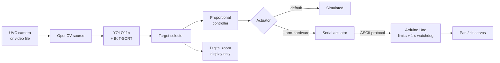

# Marine PTZ Tracker

[](https://github.com/22by7-raikar/marine-ptz-tracker/actions/workflows/ci.yml)

A laptop-driven pan/tilt tracker that detects and follows a small marine target with a
USB camera and a two-servo pan/tilt mechanism. The laptop performs capture,
custom YOLO11n inference, BoT-SORT identity tracking, target selection,
proportional control, telemetry, and serial communication. An Arduino Uno
validates bounded commands and owns the final servo-output safety boundary.

It runs on a desk-scale rig built from hobby parts. It is not a navigation
system, an unattended surveillance system, or safety-certified equipment.

https://github.com/user-attachments/assets/c84c46f1-63f1-40c4-8cee-3291b3216307

## Architecture



Camera, detector, selector, controller, and actuator sit behind typed
interfaces in `src/marine_ptz/interfaces.py`, so the whole pipeline is tested
with fakes. Digital zoom is a display/recording crop only; detection, selection,
and control always use full-frame coordinates.

Two runtimes share one composition root (`vision_cli.py`). `single` is the
default and rollback path. `concurrent` runs capture, inference, and an
optional recorder in their own threads, joined by capacity-one latest-value
channels so stale frames are replaced rather than queued; only the main
context selects targets or touches the actuator. Module, thread, startup, and
state diagrams are in [architecture](docs/architecture.md).

## Target selection

`none` → `acquiring` → `locked` ⇄ `occluded` (state diagram in
[architecture](docs/architecture.md#target-selector-states)).

A new track ID must clear the acquisition threshold (0.60) on two distinct
frames. BoT-SORT keeps a lower 0.20 support threshold so an existing ID survives
brief low-confidence frames. While occluded, the lock is protected for 0.30 s
but **no cached or predicted box reaches the controller**; lost-target policy
applies instead. A concurrent result older than `runtime.result_freshness_s` is
a fault, not a "no target".

## Control and safety boundaries

| Property | Value |
| --- | --- |
| Deadband / gain / max step | 24 px / 8.0 / 3° per update |
| Command rate | 10 Hz |
| Limits (logical and physical) | 75–105° per axis, neutral 90° |
| Physical mapping | `physical = -logical + 180` on both axes |
| Lost target | Hold the last safe pose (resent each update) |
| Firmware watchdog | Detach after 1 s without an accepted `SET` |

Limits are enforced in the controller, again after mapping in the host
actuator, and again by compile-time firmware limits. Startup runs camera and
model validation, first inference, and the `HELLO`/`READY`/`DISABLE` handshake
before `ENABLE`. Physical motion requires all three of the `arduino_serial`
backend, an explicit serial path, and `--arm-hardware`; ports are never
auto-discovered. None of this is an emergency stop: keep a direct way to remove
external servo power. See [hardware](docs/hardware.md) and
[operations](docs/operations.md).

## Installation

Python 3.10+. The verified environment is the `marine_ptz` Conda env
(Python 3.11). Install the CUDA PyTorch pair first, then constrain the project
install so it cannot replace that pair:

```bash
conda create -n marine_ptz python=3.11
conda activate marine_ptz

python -m pip install --index-url https://download.pytorch.org/whl/cu128 \
  torch==2.11.0 torchvision==0.26.0
python -m pip install --constraint constraints/vision-cu128.txt \
  --editable ".[vision,hardware,dev]"
```

For development without the vision stack, `pip install --editable ".[dev]"`
is enough: the base package imports neither NumPy, OpenCV, Torch, nor
Ultralytics. Review Ultralytics licensing before redistribution.

Model weights are local artifacts and stay out of Git (for example under the
ignored `runs/` directory). Verify the file exists and contains the
`marine_target` class before running.

## Usage

Synthetic loop (no camera, model, GPU, or serial):

```bash
python -m marine_ptz.demo --config configs/development.yaml --steps 20 --no-sleep
```

Offline replay with simulated actuation — see [evaluation](docs/evaluation.md):

```bash
python -m marine_ptz.replay_cli --config configs/development.yaml \
  --source /path/to/input.mp4 --model /path/to/best.pt --device cuda:0 \
  --target-class marine_target --tracker botsort \
  --tracker-config configs/trackers/general_botsort.yaml \
  --report artifacts/replay/report.json
```

Physical tracking, after the staged
[bring-up](docs/operations.md#bring-up):

```bash
python -m marine_ptz.vision_cli --config configs/hardware.yaml \
  --model /path/to/best.pt --device cuda:0 --target-class marine_target \
  --tracker botsort --tracker-config configs/trackers/general_botsort.yaml \
  --actuator-backend arduino_serial \
  --serial-port /dev/serial/by-id/<uno> --arm-hardware \
  --digital-zoom --max-digital-zoom 2.0 --display
```

Press `q`, Escape, or Ctrl+C for bounded shutdown; cleanup sends `DISABLE`
before closing resources.

## Testing

```bash
ruff format --check src tests tools
ruff check src tests tools
python tools/smoke_check.py
python -m pytest
tools/compile_arduino.sh
```

Tests need no camera, GPU, Arduino, or serial port. They cover tracker
configuration, selector transitions, single/concurrent ownership, stale-result
rejection, cancellation, serial faults, and Python/C++ firmware protocol parity
against shared golden vectors. CI runs Python 3.10 and 3.11 and compiles the Uno
sketch with pinned Arduino CLI 1.5.1, AVR core 1.8.8, and Servo 1.3.0.

## Results

Measured on one physical run in concurrent mode:

| Measurement | Result |
| --- | ---: |
| Unique inference rate | ~29.5 FPS |
| p95 result age at control | ~40.6 ms |
| p95 capture-to-command latency | ~57.6 ms |
| Frames with a relevant detection | 1,241 / 1,278 (97.1%) |
| Stale-result / watchdog faults | 0 / 0 |

The V3 model scored 1.000 precision, 0.936 recall, and 0.803 mAP50–95 on 36
held-out positive images; its held-out false-positive rate is unmeasured
because that split has no negatives. Details in
[evaluation](docs/evaluation.md).

## Limitations

- The dataset covers one toy in limited, controlled scenes.
- BoT-SORT can switch IDs; there is no long-term re-identification.
- Occlusion, glare, low light, similar objects, and multiple targets need
  broader evaluation.
- Hobby servos have backlash and no position feedback; commanded angle is not
  measured camera angle, and settling time is not measured.
- No optical zoom; the digital crop adds no detail.
- Long-duration thermal, mechanical, disconnect, and outdoor behavior have not
  been tested.

## Documentation

- [Architecture](docs/architecture.md) — diagrams, ownership, lifecycle, failure paths
- [Design trade-offs](docs/design_tradeoffs.md) — pros and cons of each algorithm and design choice
- [Hardware](docs/hardware.md) — components, wiring, limits, calibration
- [Operations](docs/operations.md) — bring-up, shutdown, failure response
- [Evaluation](docs/evaluation.md) — model metrics, replay, benchmarks
- [Dataset and training](docs/dataset_training.md)
- [Decisions](docs/decisions.md)
- [Firmware protocol](firmware/ptz_controller/README.md)

API reference for the Python package and firmware is generated with
[Doxygen](https://www.doxygen.nl/) (verified with 1.18, which renders the
Mermaid diagrams) and Graphviz:

```bash
doxygen            # writes build/doxygen/html/index.html
```

## Responsible use

Operate only under direct supervision in a controlled area with a physical
power-removal path. Do not use this for navigation, collision avoidance, life
safety, autonomous-vessel control, identifying people, or unattended
monitoring. Obtain permission before recording, and review recordings for private
paths, credentials, or faces before publishing.

No license is included pending ownership clarification.
