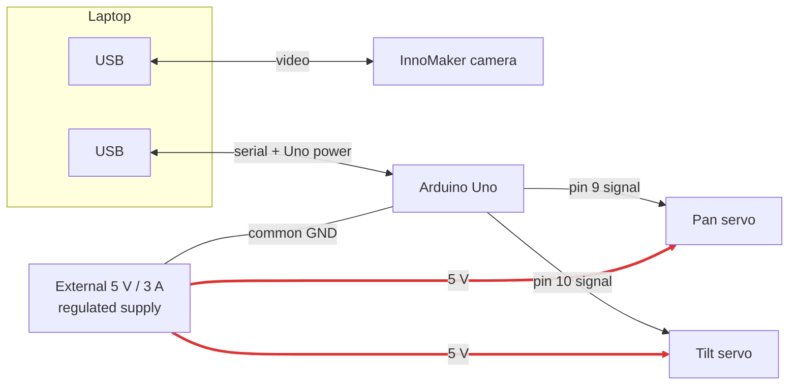

# Hardware

> **Never power the servos from the Uno 5 V pin or laptop USB.** Use the
> external regulated 5 V supply and connect its ground to Arduino ground.

## Components

| Item | Notes |
| --- | --- |
| Ubuntu laptop, NVIDIA RTX 3060 Laptop GPU | Capture, inference, control, and serial host. |
| InnoMaker U20CAM-1080P (UVC) | 1920×1080 MJPEG at 30 FPS. Fixed focus; no optical zoom. |
| Arduino Uno R3 | Protocol, limit, and watchdog boundary. Firmware in [`firmware/ptz_controller`](../firmware/ptz_controller/README.md). |
| XiaoR Geek two-servo pan/tilt bracket with two SG90-class servos | Hobby servos: backlash, flex, no position feedback. |
| Regulated 5 V / 3 A external supply | Dedicated servo power. |
| Green Toys tugboat | The one-class physical target (`marine_target`). |
| Multimeter | Required for polarity and voltage checks. |

## Wiring



Thick red lines carry servo current; the Uno only supplies signal and shares
ground.

| Device | Connection | Notes |
| --- | --- | --- |
| Camera | Laptop USB | `/dev/v4l/by-id/usb-Innomaker_Innomaker-U20CAM-1080p-S1_SN0001-video-index0` |
| Uno | Laptop USB | `/dev/serial/by-id/usb-Arduino__www.arduino.cc__0043_9503331303135180C052-if00` |
| Pan servo signal | Uno pin 9 | |
| Tilt servo signal | Uno pin 10 | Physical 95° tilts up, 85° tilts down. |
| Both servos V+ / GND | External 5 V supply | |
| Uno GND | External supply GND | Common ground is required for the signal reference. |

Use the `/dev/serial/by-id` and `/dev/v4l/by-id` paths rather than
`/dev/ttyACM*` or `/dev/video*`, which can change between boots. Serial ports
are never auto-discovered; the path must be supplied explicitly.

USB powers the Uno and carries serial data; the external supply provides servo
current. Keep servo power leads short and suitably sized.

## Before applying power

1. Disconnect external servo power while changing any wiring.
2. Meter-check supply polarity and voltage.
3. Mechanically center the bracket before attaching horns.
4. For a first powered test, remove the camera and connect one servo only.
5. Keep a direct way to remove external servo power within reach. The firmware
   watchdog is a communication fallback, not an emergency stop.

If the assembly behaves erratically, remove power and check supply capacity,
ground continuity, polarity, and mechanical binding before changing software.

## Limits and calibration

Both axes are limited to **75–105°** with neutral at **90°**, enforced three
times: logical limits in the controller, mapped physical limits in the host
actuator, and compile-time limits in the firmware
([`protocol_config.h`](../firmware/ptz_controller/protocol_config.h)). Both
installed servos are inverted, so the host maps `physical = -logical + 180`
(neutral-preserving). Configuration validation rejects a logical range that
maps outside the physical range, and the firmware rejects any angle outside
its own limits regardless of host configuration.

Recalibrate after any mechanical, wiring, or power change, one axis at a time:

```bash
python tools/calibrate_ptz.py \
  --config configs/hardware.yaml \
  --port /dev/serial/by-id/usb-Arduino__www.arduino.cc__0043_9503331303135180C052-if00 \
  --axis pan \
  --arm-hardware
```

Repeat with `--axis tilt` after the pan session ends. The tool starts at 90/90,
holds the unselected axis at neutral, resends the current pose at 10 Hz to keep
the watchdog fed, and never exceeds the configured limits.

| Key | Action |
| --- | --- |
| `+` / `-` | Move the selected logical axis by one degree. |
| `c` | `CENTER`, then hold 90/90. |
| `t` | `STATUS`, then hold the reported position. |
| `q`, Escape, `x` | Bounded `DISABLE`, close serial, exit. |

Check, in order:

1. At 90/90, `CENTER` and `STATUS` agree; nothing buzzes, binds, or pulls a
   cable.
2. Pan: logical increase maps to physical decrease and the camera follows a
   target moving right in the image.
3. Tilt: logical increase maps to physical decrease and tilts the camera down
   toward a target below center.
4. Approach each endpoint (pan 75/105, tilt 75/105) one degree at a time. Each
   must be quiet, clear, and repeatable.

Widening the envelope is a reviewed firmware and configuration change: one
boundary on one axis, at most five degrees per trial, stopping at the first
buzzing, binding, cable tension, or supply instability, and keeping a margin
inside that point.

## Known hardware gaps

These are open findings, not implemented behavior:

- **No AVR hardware watchdog.** The Servo library generates pulses from a
  timer interrupt, so if `loop()` hangs the servos hold their last position
  and the 1 s protocol watchdog never fires. Enabling `avr/wdt.h` (for example
  `WDTO_250MS` with `wdt_reset()` in `loop`) would reset the board and float
  the outputs.
- **Detach means limp.** Watchdog expiry and `DISABLE` detach the servos; a
  mounted camera can sag the tilt axis onto its end stop.
- **Floating signal lines during reset.** Every serial open resets the Uno, and
  pins 9/10 float for roughly 1–2 s in the bootloader, which can twitch SG90s.
  10 kΩ pull-downs on both signal lines prevent this.
- **No bulk capacitance on the servo rail.** A 470–1000 µF capacitor across the
  supply near the servos absorbs stall-current dips.
- **Watchdog timeout is not negotiated.** `serial.watchdog_timeout_s` is used
  only for host-side configuration checks; the firmware value is the compiled
  1000 ms and is not reported in `READY` or `STATUS`.
